

<picture>
  <source media="(prefers-color-scheme: dark)" srcset="screenshots/logo_dark.png" />
  <source media="(prefers-color-scheme: light)" srcset="screenshots/logo_light.png" />
  
</picture>

# TD Manga Studio — Phần Mềm Dịch Truyện Tranh Manga, Manhwa, Manhua & Webtoon Cho Windows

**Công cụ dịch truyện tranh toàn diện (All-in-One Studio): Quét chữ OCR đa ngôn ngữ · Xóa chữ AI LaMa · Dịch theo ngữ cảnh & Từ điển nhân vật · Chèn chữ tự động TyperTools · 22 hiệu ứng SFX · Xuất file Photoshop `.PSD` nhiều layer**

[-1e293b?style=for-the-badge&logo=windows)](https://github.com/caotiendat2000/TD-Manga-Studio/releases/latest)

<h3>
  <a href="https://github.com/caotiendat2000/TD-Manga-Studio/releases/download/v1.3.4/TD_Manga_Studio_Online_Setup.exe">⬇️ Tải Bản Cài Đặt Nhanh v1.3.4 (Khuyên Dùng — 17.65 MB)</a>
</h3>

  <a href="https://github.com/caotiendat2000/TD-Manga-Studio/releases/tag/v1.3.4">📦 Tải Bộ Cài Full Offline</a> •
  <a href="#-hình-ảnh-giao-diện-thực-tế">🖼️ Ảnh Giao Diện</a> •
  <a href="#-tính-năng-nổi-bật">✨ Tính Năng</a> •
  <a href="CHANGELOG.md">📋 Nhật Ký Cập Nhật</a> •
  <a href="#-liên-hệ-mua-key-bản-quyền--hỗ-trợ">💬 Liên Hệ Mua Key</a>

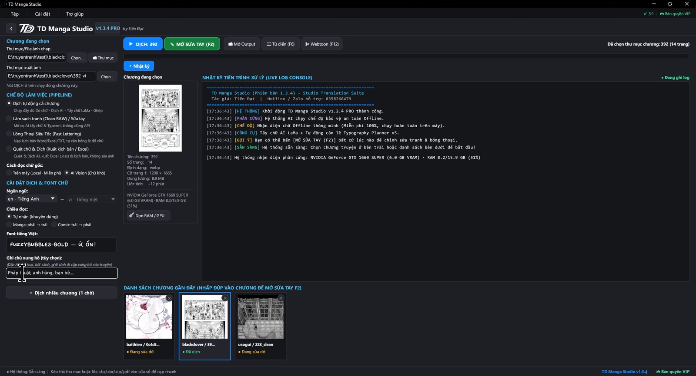

---

## 📖 Giới Thiệu TD Manga Studio

**TD Manga Studio** là phần mềm chuyên dụng trên Windows dành cho **nhóm dịch truyện tranh (Scanlation / Translator / Cleaner / Typesetter)** và người dịch cá nhân, hỗ trợ trọn vẹn quy trình làm **Manga (Nhật), Manhwa / Webtoon (Hàn), Manhua (Trung) và Comic (Anh)** sang **tiếng Việt** trong một giao diện Rust siêu mượt duy nhất.

Khác với các công cụ chỉ dịch thô từng ô chữ rời rạc, **TD Manga Studio** tích hợp sẵn **toàn bộ mô hình AI chạy cục bộ trên máy (Offline AI)** kết hợp bộ công cụ **Clean, Redraw, Typeset & QC chuyên sâu** giúp rút ngắn từ hàng giờ chỉnh tay xuống chỉ còn vài phút mỗi chương, đồng thời giữ chất lượng tranh và thẩm mỹ chữ chuẩn như làm trên Photoshop.

---

## ⬇️ Tải Xuống Phiên Bản Mới Nhất (v1.3.4 PRO)

### Cách 1: Trình Cài Đặt Nhanh Online Setup ⭐ *(Khuyên dùng — 1 click tự động cài trọn bộ)*
Tải duy nhất 1 file nhỏ gọn, tự động tải trọn bộ cài đặt từ GitHub Releases với tốc độ cao, kiểm tra nguyên vẹn SHA-256, hỗ trợ tạm dừng/tiếp tục và tự cài đặt hoàn chỉnh:

| Tệp tải xuống | Dung lượng | Phiên bản | Tải trực tiếp |
| :--- | :---: | :---: | :---: |
| **`TD_Manga_Studio_Online_Setup.exe`** | `17.65 MB` | `v1.3.4 PRO` | **[⬇️ Tải Ngay](https://github.com/caotiendat2000/TD-Manga-Studio/releases/download/v1.3.4/TD_Manga_Studio_Online_Setup.exe)** |

### Cách 2: Bộ Cài Đặt Full Offline (3 tệp — Không cần mạng khi cài sang nhiều máy)
Nếu bạn muốn lưu bộ cài đặt đầy đủ vào USB / ổ cứng để cài offline, tải đủ **cả 3 tệp sau để chung 1 thư mục** rồi chạy `TD_Manga_Studio_Setup.exe`:

| Tệp | Dung lượng | Tải từ GitHub Release v1.3.4 | Mã kiểm tra `SHA-256` |
| :--- | :---: | :---: | :--- |
| `TD_Manga_Studio_Setup.exe` | `2.96 MB` | [⬇️ Tải xuống](https://github.com/caotiendat2000/TD-Manga-Studio/releases/download/v1.3.4/TD_Manga_Studio_Setup.exe) | `400627b3101eebecba193455ffa71cefbe895ad64886b1a1d9b612b61bfe28a8` |
| `TD_Manga_Studio_Setup-1.bin` | `1.95 GiB` | [⬇️ Tải xuống](https://github.com/caotiendat2000/TD-Manga-Studio/releases/download/v1.3.4/TD_Manga_Studio_Setup-1.bin) | `1743aef6754c71d135cea90b58b2dc96b6a54dd5993f02b823723bc88d2db17a` |
| `TD_Manga_Studio_Setup-2.bin` | `1.37 GiB` | [⬇️ Tải xuống](https://github.com/caotiendat2000/TD-Manga-Studio/releases/download/v1.3.4/TD_Manga_Studio_Setup-2.bin) | `165cb8afecbcd95f53d80f629aea8f477168dec60eaf293e91004f46433d6e1b` |

- **SHA-256 của `TD_Manga_Studio_Online_Setup.exe`:** `55e21645535a37b8bb51f39890bf4ea303cef8a104b463bc06ae2cc57c4e383c`

---

## ✨ Tính Năng Nổi Bật

### 1. 🔍 Quét Chữ & Nhận Diện OCR Đa Ngôn Ngữ (Chạy Offline)
- Tự động phát hiện khung bóng thoại, chữ ngoài nền (SFX / chú thích) và chữ dọc/ngang với mô hình phân vùng chuyên biệt cho truyện tranh.
- Tích hợp sẵn **Manga-OCR** (chuyên tiếng Nhật đọc cực chuẩn cả chữ viết tay, furigana, dọc/ngang) và **EasyOCR** hỗ trợ **Tiếng Hàn (Manhwa), Tiếng Trung (Manhua), Tiếng Anh (Comic)**.
- Tự động phân loại vùng chữ (thoại chính, suy nghĩ, kể chuyện, SFX) để chọn font và kiểu hiển thị phù hợp.

### 2. 🧹 Xóa Chữ AI LaMa & Bộ Cọ Clean / Redraw Chuyên Nghiệp
- **Cọ xóa AI LaMa (Anime-Manga Big-LaMa)** tái tạo nền phức tạp, hoa văn, tóc, screentone mượt mà mà không làm nhòe tranh gốc.
- Bộ công cụ chỉnh tay đầy đủ ngay trên canvas: **Cọ tô màu / Lấp dải màu (`P`)**, **Dấu sao chép Clone Stamp (`S`)**, **Cọ vẽ nét Manga (`R`)**, **Cọ phục hồi ảnh gốc (`Y`)**, **Giữ phím `Space` để soi ảnh gốc trước/sau tức thì**, cùng hệ thống **Hoàn tác / Làm lại (`Ctrl+Z` / `Ctrl+Y`)** không giới hạn bước vẽ.

### 3. 🤖 Dịch Theo Ngữ Cảnh Cả Chương & Từ Điển Nhân Vật (`F6`)
- Dịch tự nhiên sát văn phong truyện tranh Việt Nam, nắm bắt mạch hội thoại xuyên suốt cả chương thay vì dịch rời từng câu.
- **Từ điển Nhân vật & Xưng hô cố định (`F6`):** Khóa tên riêng, chiêu thức, địa danh và cặp xưng hô giữa các nhân vật (ví dụ: *Ta – Ngươi, Anh – Em, Sư phụ – Đồ nhi*) đồng nhất 100% từ chương 1 đến chương 1000.

### 4. ✍️ Chèn Chữ Siêu Tốc TyperTools, Gradient 360°, Clipping Mask & 22 Hiệu Ứng SFX
- **TyperTools tích hợp:** Đổ toàn bộ kịch bản lời thoại vào đúng từng bóng thoại chỉ trong tích tắc, tự động căn giữa và tối ưu cỡ chữ vừa khít khung thoại.
- **Tô màu chuyển sắc Gradient 360°** tùy biến góc xoay & nhiều điểm dừng màu.
- **Lồng ảnh họa tiết (Clipping Mask)** vào chữ cho tiêu đề / SFX cực bắt mắt.
- **Kho 22 hiệu ứng chữ SFX có sẵn** (tan biến, uốn cong theo đường dẫn, viền nhiều lớp, đổ bóng, phát sáng, nghiêng phối cảnh...) kèm bộ **font chữ truyện tranh Việt hóa tuyển chọn** (hỗ trợ tự thêm font `.ttf`/`.otf` tùy thích).

### 5. 🧩 Quy Trình Làm Việc Nhóm, Kiểm Lỗi QC, Webtoon & Xuất File `.PSD`
- **Xuất / Nạp kịch bản Excel & Word** giúp phân công Dịch giả – Biên tập – Typesetter cực kỳ linh hoạt.
- **Kiểm tra lỗi toàn chương QC (`F7` / `F8`):** Tự rà soát lỗi chính tả tiếng Việt, tràn khung chữ, câu chưa dịch hoặc bóng thoại bị bỏ sót.
- **Ghép / Cắt trang Webtoon thông minh né bóng thoại** & **Đóng dấu Logo / Watermark hàng loạt (`F12`)**.
- **Xuất nhiều định dạng:** `PNG`, `JPG`, `WEBP`, `PDF`, `CBZ` và đặc biệt là **xuất file Photoshop `.PSD` tách riêng từng Layer chữ & Layer nền sạch** để tinh chỉnh nâng cao khi cần.

---

## 🖼️ Hình Ảnh Giao Diện Thực Tế

### Quy trình Quét chữ AI · Xóa nền LaMa · Vẽ & Phục hồi nét Manga

| Tự quét chữ & tạo vùng chọn Mask xóa AI | Cọ xóa AI LaMa & bộ cọ xử lý nền khó |
| :---: | :---: |
| 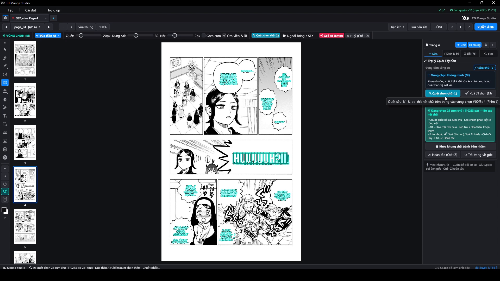 | 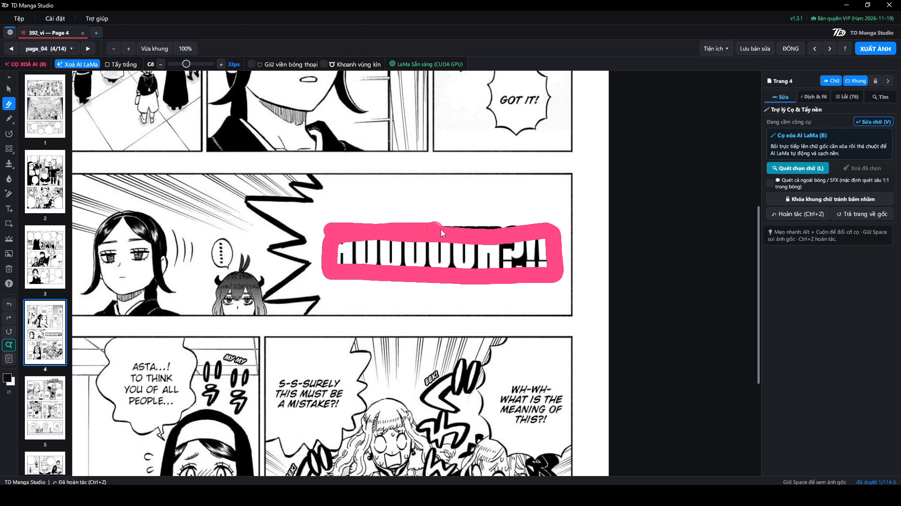 |

| Bộ cọ vẽ nét Manga & Phục hồi nền gốc | Từ điển nhân vật & Xưng hô cố định (`F6`) |
| :---: | :---: |
| 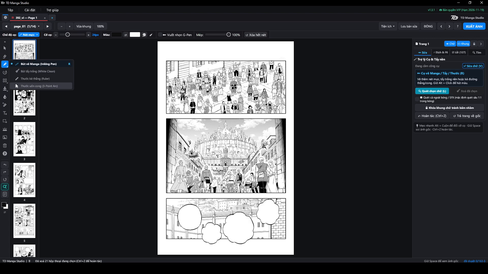 | 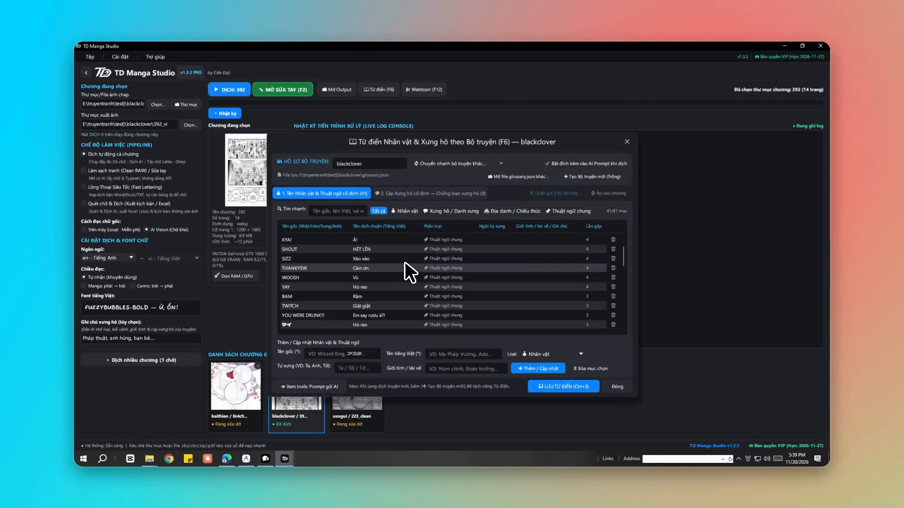 |

### Dịch tự động · Lồng thoại TyperTools · Hiệu ứng Chữ & SFX

| Kết quả dịch tự động trực quan trong Studio | Lồng thoại siêu tốc TyperTools tự đổ vào bóng |
| :---: | :---: |
| 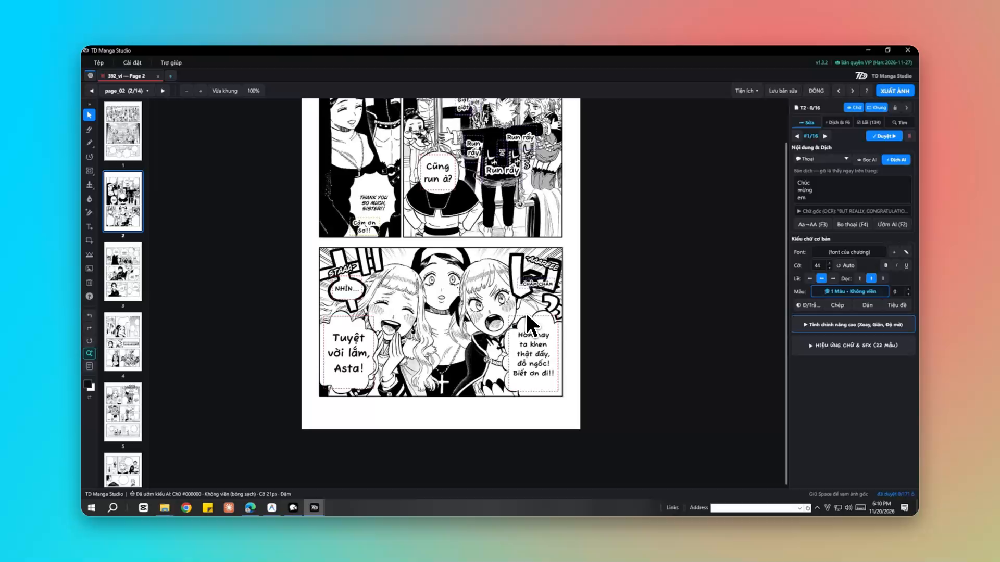 | 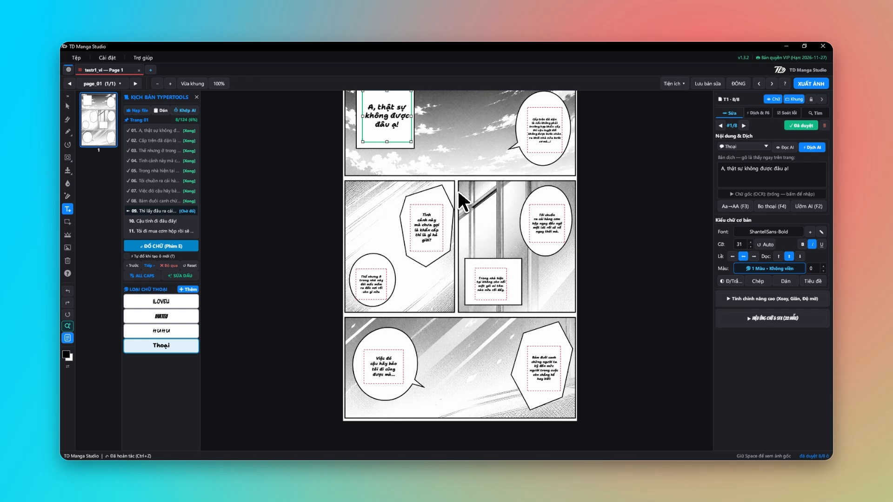 |

| Tô màu chuyển sắc Gradient 360° | Lồng ảnh họa tiết (Clipping Mask) vào chữ |
| :---: | :---: |
| 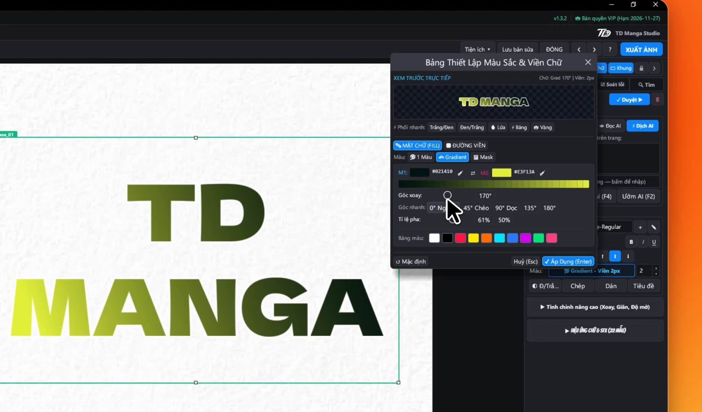 | 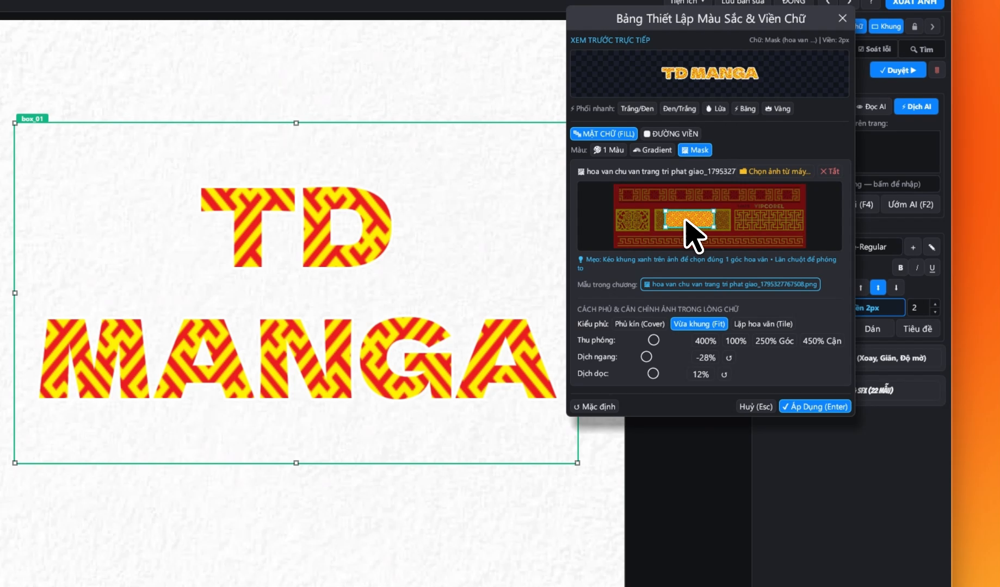 |

| 22 hiệu ứng chữ SFX: Tan biến & Uốn cong | Xuất/Nạp kịch bản Excel, Word & Tiện ích nhóm |
| :---: | :---: |
| 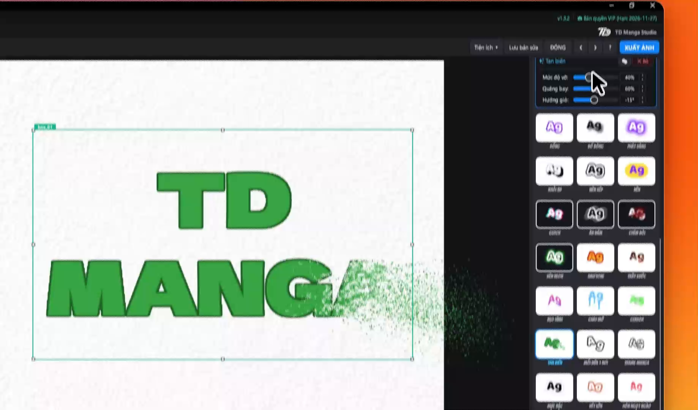 | 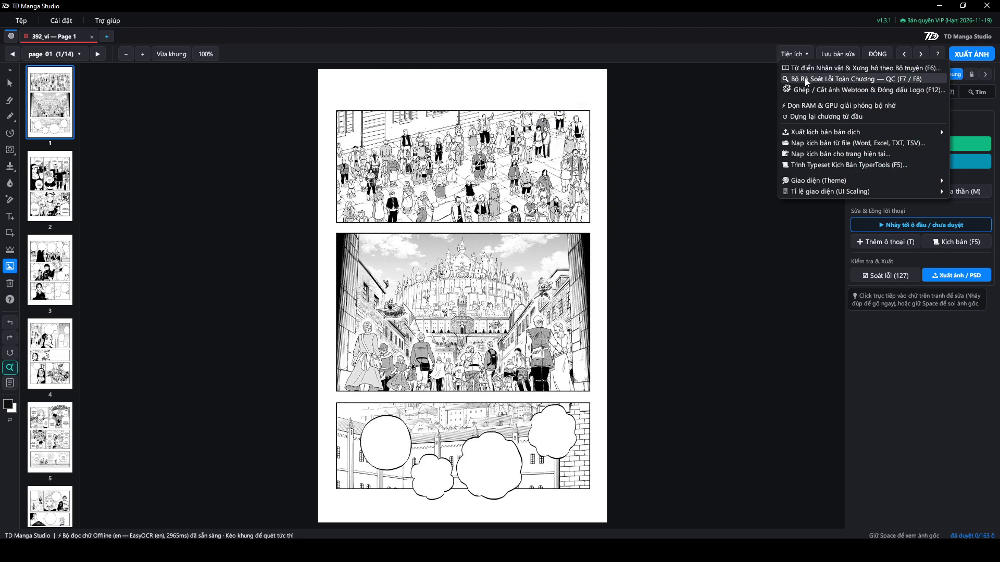 |

### Kiểm lỗi QC · Xử lý Webtoon · Xuất file Photoshop `.PSD` nhiều layer

| Kiểm tra lỗi toàn chương QC (`F7` / `F8`) | Ghép cắt Webtoon né bóng thoại & Đóng logo (`F12`) |
| :---: | :---: |
| 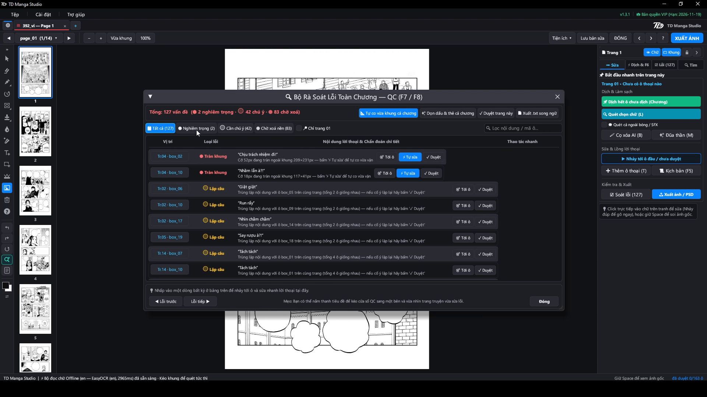 | 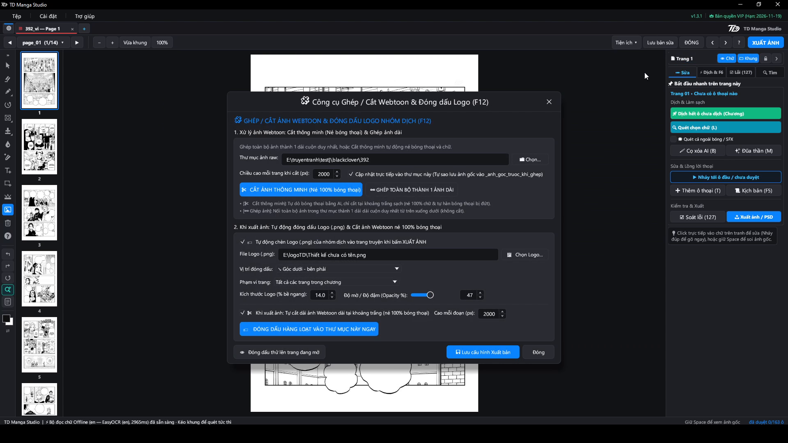 |

  <b>Xuất đa định dạng (PNG, JPG, WEBP, CBZ, PDF) và file Photoshop <code>.PSD</code> nhiều layer chỉnh sửa được</b>  
  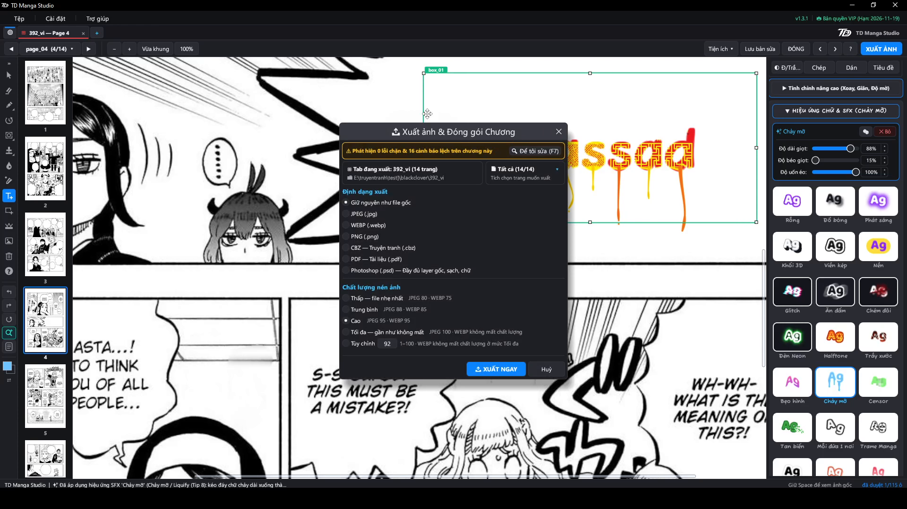

---

## 💻 Yêu Cầu Hệ Thống

| Thành phần | Tối thiểu | Khuyên dùng |
| :--- | :--- | :--- |
| **Hệ điều hành** | Windows 10 (64-bit) | Windows 10 / Windows 11 (64-bit) |
| **RAM** | 8 GB | 16 GB trở lên |
| **Card đồ họa (GPU)** | Không bắt buộc *(tự chạy chế độ CPU ổn định)* | NVIDIA GTX 1650 / RTX (4 GB+ VRAM, hỗ trợ CUDA tăng tốc AI) |
| **Ổ cứng trống** | 6 GB *(cho toàn bộ mô hình AI offline & font chữ)* | 10 GB SSD |

---

## 🚀 Hướng Dẫn Cài Đặt & Dùng Thử 3 Ngày Miễn Phí

1. Tải về **[`TD_Manga_Studio_Online_Setup.exe`](https://github.com/caotiendat2000/TD-Manga-Studio/releases/download/v1.3.4/TD_Manga_Studio_Online_Setup.exe)** (hoặc 3 file của bộ cài Full Offline).
2. Chạy trình cài đặt, chọn thư mục muốn cài đặt *(có thể chọn ổ `C:`, `D:`, `E:`... tùy ý)* rồi bấm **Bắt Đầu Tải & Cài Đặt**.
3. Sau khi cài xong, mở **TD Manga Studio** từ màn hình Desktop:
   - Máy mới sẽ được kích hoạt tự động **3 ngày dùng thử miễn phí đầy đủ tính năng** để bạn trải nghiệm thực tế trên truyện của mình.
   - Khi muốn nâng cấp bản quyền chính thức, bấm **"Sao chép mã máy"** trên cửa sổ bản quyền và gửi qua Zalo / WhatsApp / Email bên dưới để nhận mã kích hoạt ngay.
4. *(Mẹo Windows SmartScreen)*: Do bộ cài là phần mềm độc lập chưa đăng ký chứng thư doanh nghiệp Windows, nếu hiện bảng xanh *Windows protected your PC*, bạn chỉ cần bấm **More info (Thông tin thêm) → Run anyway (Vẫn chạy)** — bạn luôn có thể đối chiếu mã **SHA-256** công khai ở bảng phía trên.

---

## 💬 Liên Hệ Mua Key Bản Quyền & Hỗ Trợ

Nếu bạn cần tư vấn gói bản quyền (tháng / năm / vĩnh viễn), hỗ trợ cài đặt hoặc góp ý tính năng mới, vui lòng liên hệ trực tiếp tác giả **Cao Tiến Đạt (TD Studio)**:

- 📱 **Zalo:** [`0358266479`](https://zalo.me/0358266479)
- 💬 **WhatsApp:** [`+84 358 266 479`](https://wa.me/84358266479) (`0358266479`)
- 📧 **Email:** [caotiendat2000@gmail.com](mailto:caotiendat2000@gmail.com)
- 🐛 **Báo lỗi & Đề xuất tính năng:** Mở mục [GitHub Issues](https://github.com/caotiendat2000/TD-Manga-Studio/issues)

---

## ❓ Câu Hỏi Thường Gặp (FAQ)

### TD Manga Studio hỗ trợ dịch những ngôn ngữ truyện tranh nào?
TD Manga Studio hỗ trợ nhận diện chữ (OCR) và dịch trọn bộ truyện tranh **tiếng Nhật (Manga)**, **tiếng Hàn (Manhwa / Webtoon)**, **tiếng Trung (Manhua)** và **tiếng Anh (Comic)** sang **tiếng Việt** ngay trên máy tính Windows.

### Máy tính không có card đồ họa rời (GPU NVIDIA) có chạy được TD Manga Studio không?
**Có.** TD Manga Studio tự động nhận diện card NVIDIA CUDA để tăng tốc AI, đồng thời tự động chuyển sang chế độ **CPU ổn định** trên mọi máy tính Windows 10/11 64-bit không có card rời.

### Xuất file Photoshop (`.PSD`) từ TD Manga Studio có giữ riêng từng layer để sửa tiếp không?
**Có.** Phần mềm hỗ trợ xuất file `.PSD` tách riêng lớp tranh gốc, lớp nền đã xóa chữ sạch và các lớp văn bản, giúp nhóm dịch dễ dàng mở lại trên Adobe Photoshop để tinh chỉnh khi cần.

### Làm thế nào để dùng thử TD Manga Studio miễn phí trên Windows?
Bạn chỉ cần tải tệp **[`TD_Manga_Studio_Online_Setup.exe`](https://github.com/caotiendat2000/TD-Manga-Studio/releases/download/v1.3.4/TD_Manga_Studio_Online_Setup.exe)** từ trang GitHub Releases chính thức và cài đặt. Máy cài mới sẽ tự động được kích hoạt **3 ngày dùng thử miễn phí** đầy đủ tính năng.

### TD Manga Studio có hỗ trợ cắt ghép trang Webtoon dài và chèn logo nhóm dịch không?
**Có.** Tiện ích **Webtoon & Đóng dấu (`F12`)** hỗ trợ ghép và cắt trang dài thông minh tự động né bóng thoại, đồng thời đóng logo hoặc watermark hàng loạt cho cả chương truyện.

---

## 📄 Bản Quyền (License)

**TD Manga Studio** là phần mềm thương mại độc quyền thuộc sở hữu của **TD Studio (Cao Tiến Đạt)** — xem chi tiết tại tệp [LICENSE](LICENSE).  
Kho lưu trữ này chỉ dùng để phát hành bộ cài đặt chính thức, tài liệu hướng dẫn và tiếp nhận phản hồi từ người dùng.

---

  <b>Từ khóa tìm kiếm:</b> TD Manga Studio, phần mềm dịch truyện tranh AI, công cụ dịch manga tự động, phần mềm dịch manhwa webtoon manhua sang tiếng Việt, xóa chữ truyện tranh AI LaMa, Manga OCR Windows, TyperTools typesetting tự động, xuất file PSD nhiều layer truyện tranh, manga translator windows, comic translator AI, manhwa cleaner typesetter.

